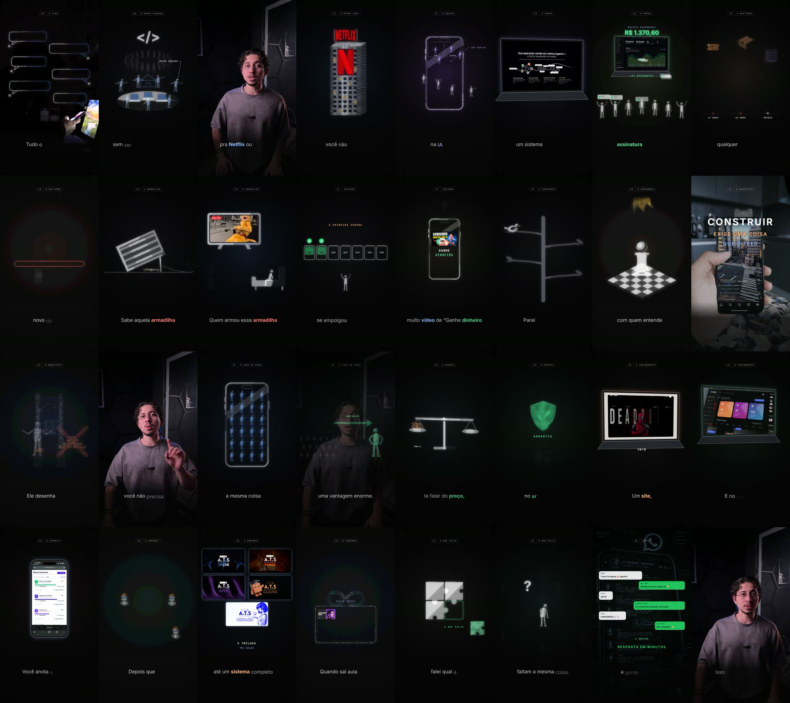

# pluginvideo: o estilo "Campo Vivo" da Salg/ATS

Plugin do Claude Code com tudo o que usamos para produzir **VSL, reels, carrosséis e landing pages** no estilo visual da ATS. Milhares de caracteres ASCII limpos formam o símbolo de cada frase da narração, ao lado de mídia real (prints do SALG, logos, b-rolls), de um boneco articulado que representa quem assiste e do narrador em cena.

Referência atual: a **VSL ATS v4** (12:33, 24/10/2026), feita com o Hook ao bloco 4 e a Parte 2 (nossas) mais a Parte 3 do Emmanuel.



## O que vem no plugin `salg-motion`

| tipo | nome | para quê |
|---|---|---|
| skill | `ascii-onetake` | **O estilo e o motor.** O `DOC-ESTILO.md` é o documento único (estilo, vídeo, carrossel, web, histórico). Traz o `motor-campo-vivo/` atual (render, som, junção das partes, mídia, narrador, `comum.js`) e o exemplo da VSL ATS v4. O motor realista antigo e o exemplo Confeiteira ficam para reels nesse visual |
| skill | `carrossel-campo-vivo` | O filme congelado em slides 4:5 |
| skill | `landing-campo-ascii` | O estilo numa landing page: `campo-ascii.js` na leitura limpa (fusão, sem amarelo) e `base.css` com os tokens novos |
| skill | `onetake` | O método de origem. De terceiros: ver as licenças abaixo |
| skill | `hairline-create` | Figuras isométricas de traço fino. De terceiros: ver as licenças abaixo |
| comando | `/ajustar-vsl` | Aplica uma lista de ajustes por minutagem, confere em stills, renderiza e junta |
| comando | `/juntar-vsl` | Junta as partes com passagem fluida e confere as emendas |
| comando | `/novo-reel` | Cria um reel novo a partir do áudio e segue até o render |
| comando | `/render-reel` | Stills, som, render inteiro ou só de um trecho |
| comando | `/fechar-reel` | Marca a versão postada, salva referências, limpa os frames |
| agente | `diretor-motion` | Transforma a transcrição em conceito + beat sheet (com pose do boneco e mídia real) |
| agente | `revisor-motion` | QA antes de entregar: checagens, stills, emendas, loudness, checklist |

## O que mudou na 2.0.0 (24/10/2026)

- **Estilo novo, "Campo Vivo"** (pacote do Emmanuel + os ajustes do Igor na VSL):
  - textura limpa em grade de 4 px e fusão no lugar;
  - câmera parada;
  - boneco articulado sempre em ação;
  - mídia real em mockups;
  - dinheiro como cédula e cartão;
  - **sem amarelo**: valor verde, dono azul, construção laranja Claude ou marrom, ouro só em tesouro.
- **Documento único** `DOC-ESTILO.md`, no lugar de DOC-PRODUCAO-VIDEOS, DOC-LANDING-PAGE-ESTILO e DOC-CARROSSEL-ESTILO, que foram para `references/antigos/`.
- **Motor novo** `motor-campo-vivo/`, com:
  - `comum.js`: cédula, cartão, lettering sem tarja, mockups, TV ligando, página em 3D, artes;
  - `juntar.py`: partes com sobreposição fluida e partes prontas de terceiros;
  - `alinhar_takes.py` + `prep_vitor.py`: o narrador sincronizado pelo áudio;
  - `prep_media.py`, `matte_run.py`;
  - `render.py`, que não trava mais quando a página demora a abrir.
- **Narrador:** fade de 0,6 s e corte em L. Nas emendas, o b-roll seguinte já roda por baixo dele, sincronizado quadro a quadro.
- **Exemplo novo** `exemplos/vsl-ats/`: o código das duas partes da VSL v4.
- **Landing:** campo na leitura limpa, botão de oferta verde, grão a 0,02.
- **Skill nova** `carrossel-campo-vivo` e comandos novos `/ajustar-vsl` e `/juntar-vsl`.
- **Comparativo** com a Parte 3 do Emmanuel (`references/ESPEC-PARTE3-EMMANUEL.md`).

## Instalar

O repositório é **privado**: cada sócio precisa ter acesso a `salgsystem/pluginvideo` no GitHub e o Git da máquina logado (Git Credential Manager ou `gh auth login`).

No Claude Code:
```
/plugin marketplace add salgsystem/pluginvideo
/plugin install salg-motion@salg-video
```
Para atualizar depois: `/plugin marketplace update salg-video`.

### Dependências da máquina (uma vez)
```
pip install -r plugins/salg-motion/skills/ascii-onetake/motor-campo-vivo/requirements.txt
python -m playwright install chromium
winget install Gyan.FFmpeg        (ou ffmpeg no PATH de outro jeito)
```
O Node.js serve para checar a sintaxe (`node --check`). No primeiro uso, o Whisper baixa o modelo `large-v3` (~3 GB). No Windows sem GPU com cuBLAS, a transcrição roda no CPU (~1 min por 30 s de áudio).

## Usar

**VSL (Campo Vivo):** peça em linguagem natural ("faz a parte 4 da VSL desse áudio", "aplica esses ajustes: 1:30 …") ou use `/ajustar-vsl` e `/juntar-vsl`. A estrutura de pastas está no `DOC-ESTILO.md` §10 e no `motor-campo-vivo/LEIA-ME.md`:
```
<projeto>/
  partes/  comum.js  juntar.py  prep_media.py  prep_vitor.py  media_comum/
           <parte>/projeto/   comp.html comp.js words.js vo.wav mix.wav render.py sfx.py …
  imagens/  TAKES VITOR …/
  video/    só o filme juntado da versão atual
```

**Reel (realista):**
1. Crie uma pasta-mãe e jogue o áudio em `gravacao/`.
2. Rode `/novo-reel "reels DD MM/reel-nome"`.
3. Depois de postar, rode `/fechar-reel`.

**Carrossel e landing:** peça "um carrossel/landing no estilo da VSL". As skills `carrossel-campo-vivo` e `landing-campo-ascii` entram sozinhas.

Documentação completa dentro do plugin:
- `plugins/salg-motion/skills/ascii-onetake/references/DOC-ESTILO.md`: **o documento principal**.
- `plugins/salg-motion/skills/ascii-onetake/motor-campo-vivo/LEIA-ME.md`: o motor peça por peça.
- `plugins/salg-motion/skills/ascii-onetake/references/antigos/`: os documentos substituídos (histórico).

## Licenças de terceiros: leia

Este repositório inclui duas skills que **não são da Salg**, copiadas com os arquivos originais:

- **`onetake`**: © 2026 Patrick (github.com/feitangyuan), licença **PolyForm Noncommercial 1.0.0** (arquivo `skills/onetake/LICENSE`): **uso apenas não comercial**. Produzir vídeos de venda é uso comercial. Para uso comercial é preciso uma licença do autor.
- **`hairline-create`**: estilo e motor de `@lucasmarkes/hairline`; **sem arquivo de licença** (por padrão, todos os direitos reservados ao autor).

Elas foram incluídas por decisão da Salg, ciente desses termos. O que é nosso (as skills `ascii-onetake`, `carrossel-campo-vivo` e `landing-campo-ascii`, os comandos, os agentes e os motores) não depende de copiar código delas para funcionar.

As fontes em `skills/ascii-onetake/motor/fonts/` (Inter, JetBrains Mono, Instrument Serif) são **OFL** (uso comercial livre).
