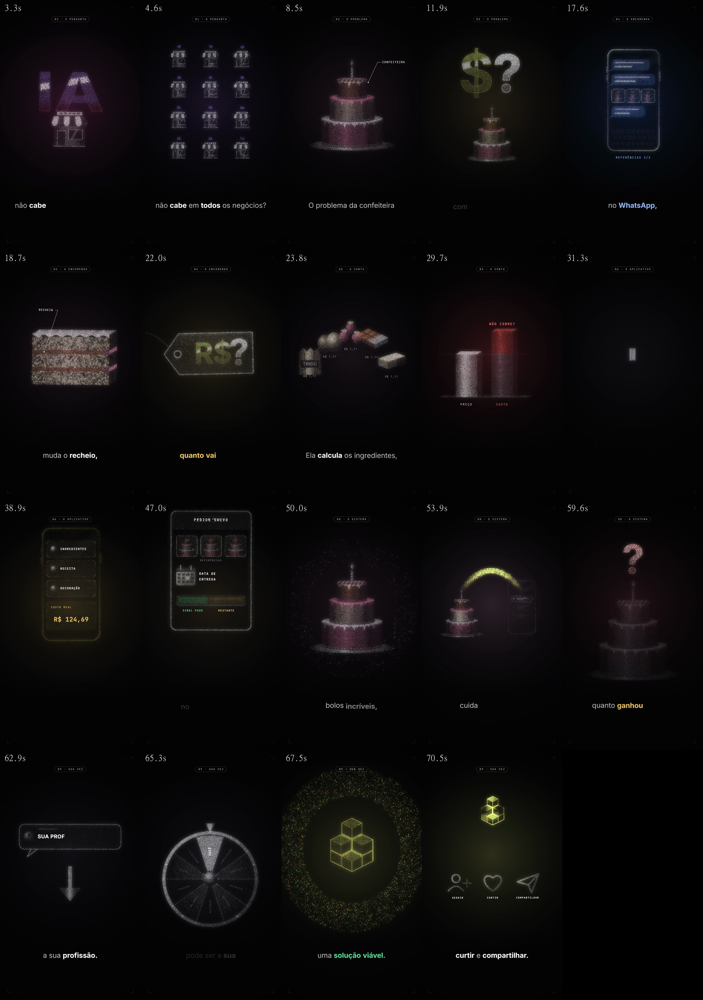

# pluginvideo: motion ASCII onetake da Salg

Plugin do Claude Code com tudo o que usamos para produzir os reels e trechos de VSL no estilo **ASCII onetake**: milhares de caracteres ASCII que, a cada frase da narração, se transformam no símbolo do que está sendo dito. Exemplo aprovado e postado: o reel **Confeiteira** (v4).



## O que vem no plugin `salg-motion`

| tipo | nome | para quê |
|---|---|---|
| skill | `ascii-onetake` | **O método e o motor**: regras de ouro, protocolo, guia de estilo, documentação completa de produção, motor (estilo realista e traço), corte de silêncios, transcrição, trilha sintetizada, render com motion blur e o exemplo completo da Confeiteira |
| skill | `landing-campo-ascii` | O mesmo estilo numa **landing page**: especificação completa, `campo-ascii.js` (testado no Chromium) e `base.css` |
| skill | `onetake` | O método de origem (composição HTML como função do tempo, carregar, câmera operada, obturador real, som numa sala só). Terceiros: ver licenças abaixo |
| skill | `hairline-create` | Figuras isométricas de traço fino (blocos, camadas, colunas). Terceiros: ver licenças abaixo |
| comando | `/novo-reel` | Cria um reel novo a partir do áudio e segue até o render |
| comando | `/render-reel` | Stills, som, render inteiro ou só de um trecho |
| comando | `/fechar-reel` | Marca a versão postada, salva referências, limpa os frames |
| agente | `diretor-motion` | Transforma a transcrição em conceito + beat sheet |
| agente | `revisor-motion` | QA antes de entregar: checagens, stills, loudness, checklist |

## Instalar

O repositório é **privado**: cada sócio precisa ter acesso a `salgsystem/pluginvideo` no GitHub e o Git da máquina logado (Git Credential Manager ou `gh auth login`).

No Claude Code:
```
/plugin marketplace add salgsystem/pluginvideo
/plugin install salg-motion@salg-video
```
Para atualizar depois: `/plugin marketplace update salg-video`.

### Dependências da máquina (uma vez)
```
pip install faster-whisper playwright numpy scipy rembg pillow
python -m playwright install chromium
winget install Gyan.FFmpeg        (ou ffmpeg no PATH de outro jeito)
```
Node.js é opcional (só checa a sintaxe). O primeiro uso do Whisper baixa o modelo `large-v3` (~3 GB). No Windows sem GPU com cuBLAS, a transcrição roda no CPU (~1 min por 30 s de áudio).

## Usar

1. Crie uma **pasta-mãe** para os reels (ex.: `Documents/Reels`) e abra o Claude Code nela.
2. Jogue o áudio narrado em `gravacao/` (a pasta é criada no primeiro uso). Se forem dois arquivos, como conteúdo + finalização, jogue os dois.
3. Rode `/novo-reel "reels 19 10/reel-nome"`, ou peça em linguagem natural ("faz o motion desse áudio no estilo ASCII onetake").
4. O Claude corta os silêncios, iguala os volumes, transcreve, monta o beat sheet, desenha as formas, mostra os stills e renderiza em `reel-nome/videos/`.
5. Depois de postar: `/fechar-reel "reels 19 10/reel-nome" v1`.

Estrutura que o plugin cria:
```
<pasta-mãe>/
  gravacao/                 caixa de entrada (o áudio sai daqui e vai para dentro do reel)
  reels 19 10/reel-nome/
    LEIA-ME.md  beat-sheet.md
    projeto/                o filme (comp.js, voz, legenda, trilha, render)
    gravacao/               originais + versão com silêncios cortados
    videos/                 versões e final
    referencias/            quadros-chave
```

Documentação completa dentro do plugin:
- `plugins/salg-motion/skills/ascii-onetake/references/DOC-PRODUCAO-VIDEOS.md`: produção completa, parâmetro por parâmetro.
- `plugins/salg-motion/skills/ascii-onetake/references/GUIA-DE-ESTILO.md`: o guia do estilo e o histórico de decisões.
- `plugins/salg-motion/skills/landing-campo-ascii/references/DOC-LANDING-PAGE-ESTILO.md`: o estilo para landing page.

## Licenças de terceiros: leia

Este repositório inclui duas skills que **não são da Salg**, copiadas com os arquivos originais:

- **`onetake`**: © 2026 Patrick (github.com/feitangyuan), licença **PolyForm Noncommercial 1.0.0** (arquivo `skills/onetake/LICENSE`): **uso apenas não comercial**. Produzir vídeos de venda é uso comercial. Para uso comercial é preciso uma licença do autor.
- **`hairline-create`**: estilo e motor de `@lucasmarkes/hairline`; **sem arquivo de licença** (por padrão, todos os direitos reservados ao autor).

Elas foram incluídas por decisão da Salg, ciente desses termos. O que é nosso (as skills `ascii-onetake` e `landing-campo-ascii`, os comandos, os agentes e o motor) não depende de copiar código delas para funcionar.

As fontes em `skills/ascii-onetake/motor/fonts/` (Inter, JetBrains Mono, Instrument Serif) são **OFL** (uso comercial livre).
